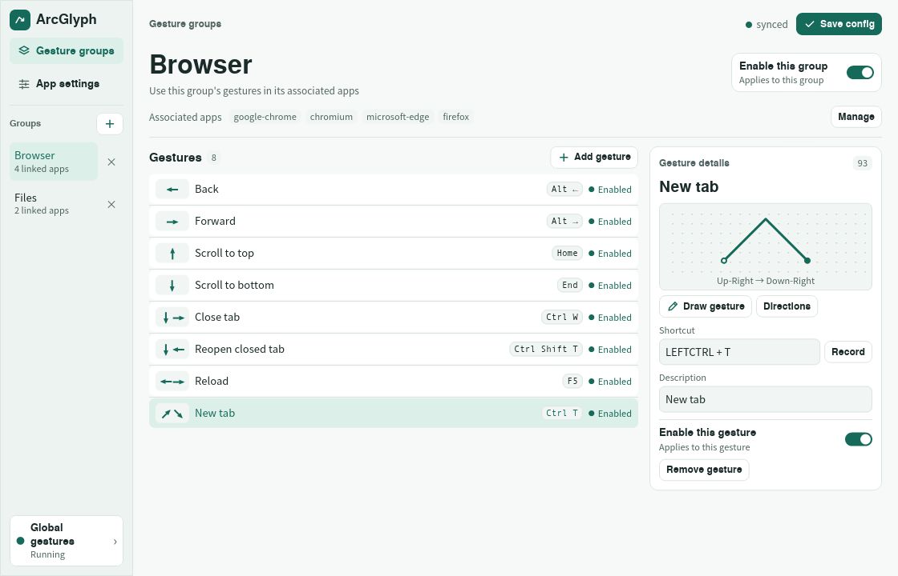
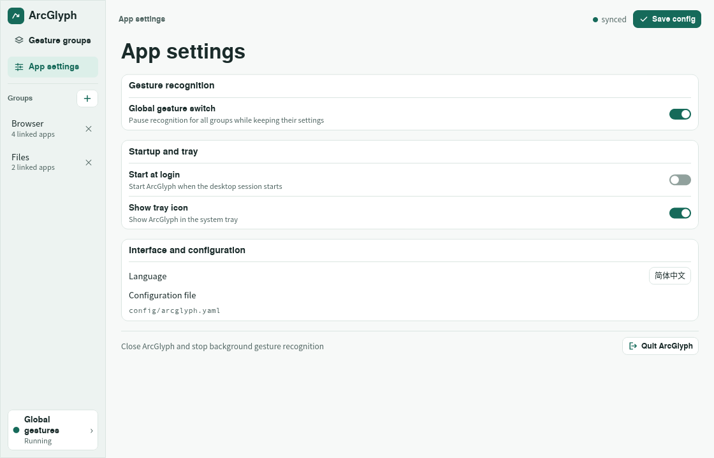

# ArcGlyph

ArcGlyph maps mouse gestures to keyboard shortcuts on KDE Plasma and GNOME
Wayland. Hold the **right mouse button**, draw a gesture, then release. ArcGlyph
shows the trail as you draw and sends the matching shortcut to the focused app.



## Quick start

Run `arcglyph` if you already have it installed. To build from this repository,
install the Rust toolchain and your distribution's development packages for
D-Bus, Wayland, libxkbcommon, Fontconfig, and udev, along with `pkg-config`.

```sh
cargo build --release --locked
./setup-perms.sh
```

The permissions script configures access to the input devices and `/dev/uinput`.
Sign out and back in so the new group membership takes effect, then run
`./target/release/arcglyph` as your regular user.

### Nix and NixOS

Build with `nix build github:lu5je0/arcglyph`, or install in your Nix profile
with `nix profile add github:lu5je0/arcglyph`. On Linux distributions other than
NixOS, configure device access with `./setup-perms.sh` from this repository.

On NixOS, add ArcGlyph to your system flake's inputs:

```nix
inputs.arcglyph = {
  url = "github:lu5je0/arcglyph";
  inputs.nixpkgs.follows = "nixpkgs";
};
```

Include the module and grant device access to your login account:

```nix
# In the modules list passed to nixpkgs.lib.nixosSystem:
[
  inputs.arcglyph.nixosModules.default
  {
    programs.arcglyph = {
      enable = true;
      users = [ "alice" ];
    };
  }
]
```

The module installs ArcGlyph, enables `uinput`, and adds the listed users to
the `input` and `uinput` groups. Sign out and back in after rebuilding to apply
group membership. Use **Start at login** in ArcGlyph to enable autostart. The
module provides a stable `/usr/bin/arcglyph` launcher for that entry.

### GNOME setup

Enable the bundled **Arcglyph Helper** extension so ArcGlyph can identify windows
and draw gesture trails on GNOME. Use `./target/release/arcglyph` in place of
`arcglyph` if you built from source.

```sh
arcglyph --install-gnome-extension
```

Sign out and back in after installing the extension, then enable it.

```sh
gnome-extensions enable arcglyph@lu5je0.github.io
```

The GNOME tray icon uses the [AppIndicator support extension](https://extensions.gnome.org/extension/615/appindicator-support/).
KDE Plasma uses KWin's scripting API for window detection.

## Set up a gesture

1. **Choose or create a group.** Click **+** next to **Groups** to add one. Use
   **Manage** to rename it or associate apps. You can type an app ID or use
   **Pick window**, then click the target window. On GNOME you have eight seconds
   to pick a window. A group with an empty app list applies to all apps.
2. **Choose or add a gesture.** Select a row to edit it in the details pane, or
   click **Add gesture**. Click **Draw gesture**, hold the **left mouse button** in
   the drawing area, and release when finished. Use **Directions** to edit the
   sequence one direction at a time.
3. **Assign a shortcut.** Click **Record** and press the shortcut you want the
   gesture to send. Enter a description so you can recognize it in the list.
4. **Save and try it.** Click **Save config**, focus one of the associated apps,
   and draw the gesture with the **right mouse button**. For example, draw ↗
   followed by ↘ to open a new tab if the shortcut is set to **Ctrl+T**.

Right-click a group and choose **Copy group** to duplicate its apps and gestures.
Each gesture has its own enable switch. Its row shows whether that individual
gesture is enabled or paused. Use the switch beside the group title to control
the whole group.

## App settings



- **Global gesture switch** pauses recognition across all groups and preserves
  their individual settings.
- **Start at login** starts ArcGlyph with the desktop session. **Show tray icon**
  controls whether its icon appears in the system tray.
- **Language** switches between English and Simplified Chinese. The page also
  shows the active configuration file.
- **Quit ArcGlyph** closes the app and stops background recognition. Closing the
  preferences window leaves ArcGlyph running in the background. Launch ArcGlyph
  again or use **Preferences…** in the tray to reopen it.

## Gesture matching

Direction sequences use the number pad layout.

```text
  7 8 9     ↖ ↑ ↗
  4 . 6  =  ← . →
  1 2 3     ↙ ↓ ↘
```

For example, `26` means down then right, and `93` means up-right then down-right.
ArcGlyph tries the eight-direction match first, then the four-direction result
and nearby directions. A straight up-then-down stroke (`82`) can therefore
trigger `93` when no closer enabled binding applies. If equally close bindings
in the same scope send different shortcuts, ArcGlyph skips the ambiguous match.

ArcGlyph passes regular right-clicks through when the focused window is full
screen, the pointer is outside it, or the app has no applicable gestures.

## YAML configuration

Set `ARCGLYPH_CONFIG` to use a specific file. Otherwise, ArcGlyph uses
`~/.dotfiles/arcglyph/arcglyph.yaml` when that directory exists, or
`${XDG_CONFIG_HOME:-$HOME/.config}/arcglyph/arcglyph.yaml`.

```yaml
enabled: true
hide_tray: false
lang: en
groups:
  - name: Browser
    enabled: true
    apps: [google-chrome, chromium, microsoft-edge, firefox]
    gestures:
      - { label: Back, pattern: "4", keys: [LEFTALT, LEFT] }
      - { label: New tab, pattern: "93", keys: [LEFTCTRL, T] }
```

- `enabled` controls the global switch. Groups and gestures can each have their
  own `enabled` flag, which defaults to `true`.
- `apps` contains case-insensitive app ID substrings. An app-specific binding
  takes priority over a global binding for the same recognized pattern.
- `pattern` is the quoted direction sequence. `keys` contains evdev key names
  pressed together as a shortcut.
- `lang` is `en` or `zh`. `hide_tray: true` hides the tray icon.

ArcGlyph reloads the configuration when you save it in the editor or edit it on
disk.
